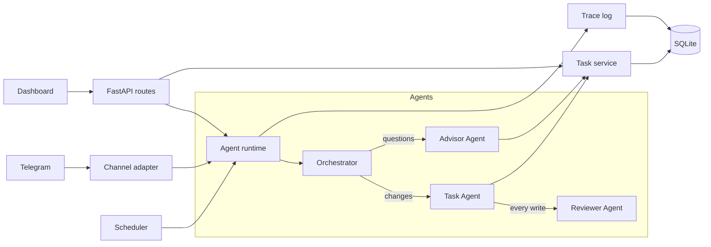

# TaskPilot

A multi-agent AI task manager you talk to in chat. Say "Create a high priority task for John to deploy the frontend by Friday" in Telegram and a team of AI agents turns it into a real task, checks it, saves it, and later reminds John before it is due.

Built for the HiDevs Multi-Agent AI Task Management System assignment.

| | |
|---|---|
| Backend | Python 3.11, FastAPI, SQLAlchemy 2 (async), SQLite |
| Agents | Four agents on the Anthropic Messages API (Claude), each with its own tools |
| Chat | Telegram, behind a channel interface so other platforms can be added |
| Proactive | APScheduler: daily plan, due-soon reminders, overdue follow-ups, weekly summary |
| Dashboard | Plain HTML, CSS and JavaScript served by FastAPI. No build step |
| Tests | 99 automated tests. None of them call a real LLM or Telegram |

## Run it

You need Python 3.11+ and [uv](https://docs.astral.sh/uv/).

```bash
uv sync                              # install dependencies
cp .env.example .env                 # then put your two keys in .env
uv run python scripts/seed.py        # optional: demo team and tasks
uv run uvicorn app.main:app --port 8000
```

Open http://localhost:8000 for the dashboard and http://localhost:8000/docs for the API.

| Key in `.env` | Where it comes from | Without it |
|---|---|---|
| `ANTHROPIC_API_KEY` | [Anthropic Console](https://console.anthropic.com/) | The task API and dashboard work. The assistant answers with an apology and the reason is shown in Agent activity |
| `TELEGRAM_BOT_TOKEN` | Message [@BotFather](https://t.me/BotFather) on Telegram and send `/newbot` | The Telegram bot does not start. The assistant is still usable from the dashboard |

With Docker: `docker compose up --build`, then open http://localhost:8000.

Run the tests with `uv run pytest`.

## How it works



There are four layers, and each one only talks to the layer below it:

1. **Channels** move text in and out. Telegram and the dashboard's assistant box are two channels into the same system.
2. **The agent runtime** runs one request from start to finish inside a single database transaction and records every step.
3. **Services** hold all task logic. They are the only code that touches the database. Agents, the REST API and the scheduler all go through them.
4. **The database** stores people, tasks, the history of every change, conversation memory, the agent trace and sent notifications.

### The agents, and why each one exists

| Agent | Job | Tools | Why it is separate |
|---|---|---|---|
| **Orchestrator** | Reads the message and the recent conversation, decides which specialist handles it and in what order, writes the reply | `ask_task_agent`, `ask_advisor_agent` | One message can need several steps ("create this, then tell me what to focus on"). Something has to plan the sequence and carry context between steps |
| **Task Agent** | Turns an instruction into exact task changes: which task, which person, which date | `find_user`, `search_tasks`, `create_task`, `update_task`, `complete_task` | It is the only agent with write tools. Precise extraction is a different job from giving advice |
| **Advisor Agent** | Answers "what should I focus on", lists and searches tasks, writes daily plans and summaries | `get_ranked_tasks`, `list_tasks`, `get_stats` | It is read-only. Whatever it does, it cannot change data |
| **Reviewer Agent** | Checks every proposed change before it is saved | none | A second opinion on the only risky step. It is called from inside the write tools, in code, so the Task Agent cannot skip it |

Two things are deliberately **not** agents:

- **Priority scoring** is arithmetic, so plain code does it ([app/services/priority.py](app/services/priority.py)) and the Advisor explains the result. The score comes with its reasons, such as "overdue by 2 days".
- **Conversation memory** is storage, so it is a table and a 40-line module ([app/services/memory.py](app/services/memory.py)).

The same principle applies to dates. The model turns "Friday" into an ISO date using today's date from its prompt, and code validates that date and compares it with the current time. The model never does date arithmetic.

### One request, step by step

"Create a high priority task for John to deploy the frontend by Friday."

1. Telegram delivers the text. The channel adapter looks up who sent it and calls `AgentRuntime.handle_chat`.
2. The **Orchestrator** sees a task change and calls `ask_task_agent` with a complete instruction.
3. The **Task Agent** calls `create_task` with a title, assignee, priority and ISO date.
4. Inside that tool, code gathers findings (a similar open task? a date in the past? an unknown person?) and passes the proposal to the **Reviewer**.
5. The Reviewer answers `approve`, `clarify` or `reject`. Anything it cannot read counts as `clarify`, so when in doubt nothing is written.
6. On approval the task service saves the task and its history entry. Otherwise the Reviewer's question goes back to the user and nothing changes.
7. The Orchestrator writes the reply. The transaction commits. The trace is saved.

Every step is stored in `agent_steps`. The dashboard's **Agent activity** screen shows the run: which agent, which tool, and the Reviewer's verdict.

### Proactive assistance

The scheduler feeds events into the same runtime, so scheduled messages come from the same Advisor that answers chat questions.

| Job | When | What it sends | Written by |
|---|---|---|---|
| Daily plan | 09:00 every day | The three tasks to do first, with reasons | Advisor Agent |
| Due-soon reminder | Every 30 minutes | One reminder per task due in the next 24 hours | A text template |
| Overdue follow-up | 10:00 every day | One message per person listing their overdue tasks and asking what to do | Advisor Agent |
| Weekly summary | Fridays at 17:00 | What was completed, what is open, what comes next | Advisor Agent |

- A single reminder uses a template because an LLM adds nothing there.
- Each notification has a unique key in the `notifications` table, so a restart or a repeated run never sends the same message twice.
- Sent messages are added to conversation memory, so a reply such as "it's done" makes sense to the agents.
- Every job can be run immediately from the Agent activity screen or with `POST /api/proactive/{job}/run`.

Times use the `TIMEZONE` setting (default `Asia/Kolkata`).

## Design decisions

- **The Reviewer gate is code, not a prompt.** A prompt that says "always check first" can be ignored. A function call cannot.
- **One transaction per request.** If the LLM fails halfway, the user gets an apology and no half-finished change remains. There is a test for exactly this.
- **Failures leave evidence.** The trace is saved in its own transaction after the work finishes or rolls back, so a failed run still shows what happened.
- **Agents are short files.** One shared loop ([app/agents/base.py](app/agents/base.py)) handles tool calling. Each agent is a prompt and a tool list.
- **The LLM sits behind one interface.** [app/agents/llm.py](app/agents/llm.py) is the only file that imports the Anthropic SDK. Tests use a scripted `FakeLLM`.
- **Channels are swappable.** A channel is one class with a `send` method ([app/channels/base.py](app/channels/base.py)). Adding Google Chat or Slack does not touch the agents.
- **Unknown people are handled, not dropped.** Assigning to someone new adds them as a team member and says so. When they later send `/start`, their Telegram account is linked to the same person.

## API

Interactive documentation is at `/docs`.

| Route | Purpose |
|---|---|
| `GET /api/tasks` | List tasks. Filters: `status`, `priority`, `assignee_id`, `q`, `overdue`, `due_before`, `due_after`. Sort: `due_at`, `score`, `priority`, `created_at`. Returns `{items, total}` |
| `POST /api/tasks` | Create a task |
| `GET /api/tasks/{id}` | One task with its change history |
| `PATCH /api/tasks/{id}` | Update fields or status |
| `GET /api/users` | Team members |
| `GET /api/stats` | Counts: open, overdue, due today, completed recently |
| `POST /api/chat` | Send a message to the agents: `{user_id, text}` → `{reply, run_id, status}` |
| `GET /api/runs`, `GET /api/runs/{id}` | Agent runs and their steps |
| `GET /api/proactive/jobs`, `POST /api/proactive/{job}/run` | Proactive jobs and a manual trigger |
| `GET /api/status` | Which parts are configured |

## Dashboard

Three screens: **Tasks**, a **task panel** that opens beside the list, and **Agent activity**.

The dashboard was built against a list of 14 UI rules. Several of them overlap, so they are grouped below. Each line says what was done and how it was checked in a real browser.

| Rule | What the dashboard does | How it was checked |
|---|---|---|
| Consistency (1, 14) | Every colour, size and spacing value is a variable in [tokens.css](app/static/css/tokens.css). One badge and button style throughout | Visual check of all three screens |
| Shortcuts and productivity (2, 13) | Keys `/` `N` `J` `K` `Enter` `E` `C` `Esc` `?`. One-click filter chips. Status changes from the table row. An assistant box that creates tasks from a sentence. Filters stored in the URL | Each key pressed in the browser. A filtered URL reloaded and the controls matched |
| Informative feedback (3) | A message after every action, loading rows, a busy state on buttons, a live result count | Messages read back after complete, create, edit and cancel |
| Closure (4) | Each action ends with a confirmation, the panel closing, the row updating and focus returning to it | Focus was on the task's row after create and after `Esc` |
| Error handling and prevention (5, 9) | Errors under the field in plain words. Save disabled until the form is valid. A past due date asks for confirmation. Server errors keep what was typed. The API enforces the same limits | Empty title, over-long title, past date, and a failed save were each triggered |
| Easy reversal (6) | Undo for 8 seconds after any change. Tasks are cancelled, never deleted, and can be restored | Complete then Undo, and Cancel then Undo, from the table and from the panel |
| User in control (7) | The list never rearranges by itself; changes made elsewhere show a "Refresh list" banner. Unsaved edits ask before closing | A task was changed through the API while the page was open: the banner appeared and the row stayed as it was until "Refresh list" was clicked. Closing an edited form asked first |
| Low memory load (8) | Active filters shown as removable chips. The panel opens beside the list. Dates read "Fri 9 Oct, in 2 days" | Visual check |
| Satisfaction and speed (10) | Changes appear immediately and roll back if the server refuses. Works at 360 px wide | Failed save rolled back and offered Retry. No horizontal scroll at 360 px |
| Accessibility (11) | Text contrast of at least 5.7:1 in the light theme and 6.6:1 in the dark theme. Keyboard-operable throughout, visible focus ring, real buttons, labels and tables, messages announced to screen readers, reduced-motion and dark-mode support | Contrast computed for every text and background pair. Keyboard run through create, edit, complete and undo. Not yet tested with a screen reader |
| Ease of use (12) | Three screens, one main action per screen, plain labels | Visual check |

## Scaling up

The current setup is sized for a demo and a small team. Each part has a clear next step.

| Today | At scale |
|---|---|
| SQLite file | Postgres through `DATABASE_URL`, with Alembic migrations. SQLite allows one writer at a time, and an agent run holds its transaction while the model thinks |
| Telegram polling inside the server | A webhook endpoint behind a load balancer |
| Scheduler inside the server | A job queue with separate workers, so jobs survive restarts and never run on two servers at once |
| Per-user lock in memory | A distributed lock, so several server copies can run |
| One timezone setting | A timezone per person |
| Specialists called one after another | Independent steps in parallel, and prompt caching for the fixed system prompts |
| One model for every agent | A smaller, faster model for the Reviewer and Orchestrator. Models are already set per role in `.env` |

## Known limits

- **No login on the dashboard.** A "Viewing as" menu picks the current person. Anyone who can open the page can act as anyone.
- **Telegram users are matched by first name.** Two people with the same first name need distinct names in the team list.
- **Reminders reach only people who have sent `/start` to the bot.** Telegram does not let a bot message someone first.
- **A request takes several LLM calls**, one per agent step, so a reply to a change takes a few seconds.
- **The dashboard has not been tested with a screen reader**, only by keyboard and by contrast calculation.

## Project layout

```
app/
  main.py            FastAPI app: starts the database, Telegram and the scheduler
  config.py          Settings from .env
  models.py          Database tables
  schemas.py         Request and response shapes, with validation
  services/          Task logic, people, priority scoring, conversation memory
  agents/            The agent loop, the four agents, their tools, the LLM client, the trace
  channels/          Telegram adapter and the channel interface
  proactive/         The four scheduled jobs and the scheduler
  api/               REST routes
  static/            The dashboard
scripts/
  seed.py            Demo team and tasks
  eval_examples.py   Runs the assignment's six example sentences against the real LLM
tests/               99 tests
docs/
  architecture.md    Architecture diagram and evaluation
  plans/             The implementation plan this was built from
```
