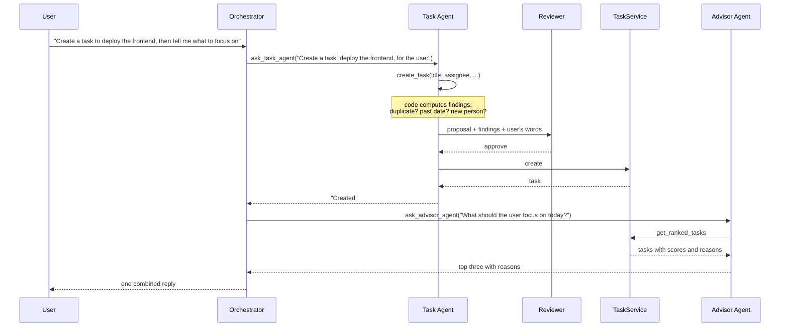

# Architecture

This document covers the architecture requirement of the assignment: the diagram, the reasoning behind the design, how the agents interact, how messages and data flow, how it scales, and an evaluation of the design the Architecture Copilot produced.

## 1. Architecture diagrams

Two diagrams: what the Architecture Copilot generated, and the final architecture of the system as it is built.

### 1a. Generated by the Architecture Copilot

Original file: [architecture-copilot.pdf](architecture-copilot.pdf)

### 1b. Final architecture, as built

### 1c. What differs between the two

The Copilot got the shape right: the same four layers, the same four agents with the same roles, a runtime that owns transactions and tracing, a polling Telegram adapter, a scheduler, and the four services. The differences are in the technology it assumed and in a few components it added or left out.

| In the Copilot's diagram | In the system as built |
|---|---|
| LangGraph as the agent framework | No framework. One shared tool-use loop, about 100 lines, in `app/agents/base.py` |
| OpenAI GPT-4o and GPT-4o-mini | Claude through the Anthropic API; the model for each agent role is a setting |
| Dashboard in React and Tailwind CSS | Plain HTML, CSS and JavaScript, served by FastAPI with no build step |
| An Nginx API gateway | None. FastAPI serves the API and the dashboard directly |
| NumPy in Priority Scoring | Plain Python arithmetic |
| A distributed lock store (cache) | An in-memory lock per user inside the Agent Runtime |
| Services drawn as separately deployed services | Modules inside the one FastAPI process |
| No LLM provider shown | Anthropic API shown as the one external dependency |
| No agent trace or notification record | Both are tables in the database and are shown |
| Database type not stated | SQLite, with Postgres as the scale-up path |

## 2. Why this architecture

The assignment asks for a multi-agent system and not a single prompt-and-response loop. The design question was therefore where the boundaries between agents should fall. Three rules decided it.

**An agent exists only where the job, the tools and the risk differ.**

| Boundary | What differs on each side |
|---|---|
| Orchestrator vs specialists | The Orchestrator holds the conversation and plans the sequence. Specialists receive one self-contained instruction and never see the chat history, which keeps their prompts short and their behaviour predictable |
| Task Agent vs Advisor Agent | The Task Agent can write; the Advisor cannot. Extraction needs precision ("which task, which person, which date"). Advice needs judgement over many tasks |
| Task Agent vs Reviewer | The agent proposing a change should not be the one approving it. The Reviewer sees the user's original words, the proposal, and findings computed by code, and nothing else |

**Anything that can be plain code is plain code.** Urgency scoring, date validation, duplicate detection and reminder deduplication are deterministic. Giving them to an LLM would make them slower, costlier and occasionally wrong. The agents call them as tools and explain the results.

**Safety properties are enforced in code, not requested in prompts.** The Reviewer runs inside the write tools, so no prompt wording can bypass it. The Advisor has no write tools at all. Each request runs in one database transaction, so a failure leaves nothing half-done.

### Alternatives considered

| Alternative | Why it was not chosen |
|---|---|
| One agent with every tool | Simplest, but it is the prompt-response workflow the assignment rules out, and one prompt has to be good at routing, extraction and advice at once |
| A fixed pipeline (classify → extract → validate → act) | Predictable, but it cannot handle a request with two parts or a follow-up that depends on the previous reply |
| More agents (memory agent, scheduling agent, planner agent) | Memory is a table and scheduling is a timer. Wrapping them in an LLM would add cost and failure modes without adding judgement |

## 3. Agent interactions and workflow

The pattern is **orchestrator with specialists as tools**. The Orchestrator is an LLM whose only tools are the other agents. Calling `ask_task_agent` starts a full Task Agent run and returns its answer as the tool result.

Things worth noticing in this flow:

- **Changes come before advice**, so the advice already includes the new task. The Orchestrator's prompt states this ordering.
- **If the Reviewer says `clarify`**, the write tool returns the Reviewer's question, nothing is saved, and the question travels back to the user. The user's answer arrives as the next message, and the Reviewer sees the recent conversation, so a confirmed duplicate is approved the second time.
- **If the Reviewer's output cannot be read**, it is treated as `clarify`. The system fails closed.
- **If a tool fails**, the error goes back to the model as a tool result so it can correct itself. If the LLM service itself fails, the whole run is rolled back.
- **Each agent stops after six steps**, so a confused model cannot loop forever.

## 4. Communication flow

| Direction | Path |
|---|---|
| User to system | Telegram → polling adapter → `AgentRuntime.handle_chat(user_id, text)` |
| System to user (reply) | The run's reply → adapter → Telegram, split into parts if longer than Telegram's limit |
| System to user (proactive) | Scheduler → job → `AgentRuntime.handle_event` or a template → `Channel.send` |
| Dashboard to system | `POST /api/chat` reaches the same `handle_chat`. REST routes reach the task service directly for manual edits |

The agents never know which platform a message came from. A channel is one class with a `name` and a `send(user, text)` method. Adding Google Chat or Slack means writing one adapter that maps the platform's user id to a `User` and calls `handle_chat`.

Messages from one person are processed in order: the runtime holds a lock per user, so two quick messages cannot interleave.

## 5. Data flow

| Data | Written by | Read by |
|---|---|---|
| `users` | `/start` in Telegram; the Task Agent when a new name is assigned | Everything |
| `tasks` | TaskService only, called by the Task Agent or the REST API | Agents, dashboard, scheduler jobs |
| `task_events` | TaskService, one row per change, with who made it (`agent:task`, `user:dashboard`) | The task panel's History |
| `messages` | The runtime after each chat turn; the scheduler after each proactive message | The Orchestrator (last 10 messages) and the Reviewer (last 4) |
| `agent_runs`, `agent_steps` | The tracer, in its own transaction after the run | The Agent activity screen |
| `notifications` | Scheduler jobs, with a unique key per notification | Scheduler jobs, to avoid sending twice |

All timestamps are stored in UTC and shown in the configured timezone.

## 6. Scalability

The design keeps state in the database and nowhere else, which is what makes each of these steps possible without changing the agents.

| Concern | Today | Next step |
|---|---|---|
| Database | SQLite. One writer at a time, and a run holds its transaction while the model thinks | Postgres via `DATABASE_URL`. Row-level locking removes the single-writer limit |
| Several server copies | A per-user lock in memory and a scheduler inside the process | A distributed lock, and the scheduler moved to a separate worker so jobs run once |
| Incoming messages | Telegram polling | A webhook endpoint behind a load balancer |
| LLM latency and cost | Every agent uses the same model; steps run one after another | A smaller model for the Reviewer and Orchestrator (already a per-role setting), parallel specialist calls, prompt caching |
| Observability | Every step is in `agent_steps` | Export the same records to a tracing system; add token counts per step |
| More chat platforms | One adapter | One more adapter per platform; no agent changes |

## 7. Evaluation of the Architecture Copilot's design

> **To write (Vinay).** The assignment asks for your own assessment of what the tool generated:
>
> - What you liked
> - What you changed, and why
> - What could be improved
>
> Sections 2 to 6 describe what was built, as material to compare against.
